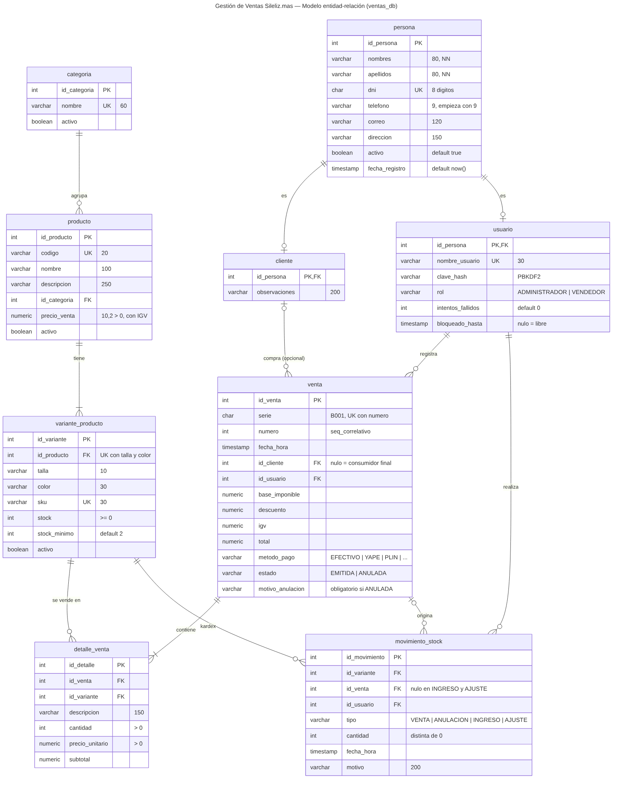
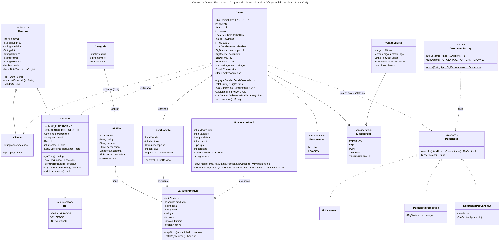

# Informe — Parte de base de datos y diseño de clases

**Proyecto:** Gestión de Ventas Sileliz.mas · **Responsable:** Rafael Alva (tarea 15 del plan v3.1)
**Fuente:** todo lo que sigue se obtuvo de la base `ventas_db` recreada con `bd/recrear_bd` y del código de la rama `develop` al 12 de noviembre de 2026. Si el código cambia, este documento se actualiza.

> Este archivo continúa el `docs/informe.md` (secciones 1 a 3, de Mateo). Las secciones se numeran 4 y 5 para unirlas en el informe final.

---

## 4. Base de datos

### 4.1 Decisiones de diseño

| Decisión | Por qué |
|---|---|
| **PostgreSQL 18**, base `ventas_db` en **UTF-8** | Tildes y ñ en nombres de clientes y productos; el mismo motor en las 5 computadoras. |
| Claves primarias **`INT GENERATED ALWAYS AS IDENTITY`** | Las genera la base: la aplicación nunca inventa un id. |
| Importes en **`NUMERIC(10,2)`** (y `BigDecimal` en Java) | El dinero no se guarda en `double`: no hay errores de redondeo. |
| **Herencia `persona` → `cliente` / `usuario`** (una tabla por subtipo) | Nombres, DNI y teléfono se guardan una sola vez; el DNI es único entre **todas** las personas (RN-04). Coincide con la clase abstracta `Persona` en Java. |
| **Stock por variante** (`variante_producto`) y no por producto | Una prenda se vende por talla y color (RN-03): "Jean mom 2XL Celeste" tiene su propio stock. |
| **Nada se borra**: columna `activo` | Lo que tiene ventas se desactiva (RN-05). Las ventas se **anulan**, nunca se eliminan (RN-08). |
| Restricciones (`CHECK`, `UNIQUE`, `FOREIGN KEY`) en la base | Son la **última barrera**: aunque el código Java tenga un error, la base no acepta un stock negativo, un DNI de 7 dígitos ni una venta anulada sin motivo. |
| Correlativo con la secuencia **`seq_correlativo`** | Dos ventas al mismo tiempo nunca reciben el mismo número de comprobante (RN-07). |
| Usuario de la aplicación **`ventas_app` sin permisos de DDL** | Si alguien encontrara una falla en la aplicación, no podría borrar ni cambiar tablas (sección 4.7). |

### 4.2 Modelo entidad-relación



*Figura 4.1. Modelo entidad-relación (fuente editable: `bd/erd_ventas_db.mmd` y `bd/erd_ventas_db.pgerd` de pgAdmin).*

**9 tablas** y sus relaciones:

| Relación | Cardinalidad | Significado |
|---|---|---|
| `persona` — `cliente` | 1 : 0..1 | Una persona puede ser cliente (subtipo). |
| `persona` — `usuario` | 1 : 0..1 | Una persona puede ser usuario del sistema (subtipo). |
| `categoria` — `producto` | 1 : N | Una categoría agrupa muchos productos. |
| `producto` — `variante_producto` | 1 : N | Un producto tiene varias tallas y colores. |
| `cliente` — `venta` | 0..1 : N | Una venta puede no tener cliente (consumidor final, RN-06). |
| `usuario` — `venta` | 1 : N | Cada venta la registra un usuario. |
| `venta` — `detalle_venta` | 1 : N | Una venta contiene una o más líneas. |
| `variante_producto` — `detalle_venta` | 1 : N | Una variante aparece en muchas líneas de venta. |
| `variante_producto` — `movimiento_stock` | 1 : N | Kárdex: cada cambio de stock queda registrado. |
| `venta` — `movimiento_stock` | 0..1 : N | El movimiento de tipo VENTA o ANULACION apunta a su venta; INGRESO y AJUSTE no. |
| `usuario` — `movimiento_stock` | 1 : N | Quién hizo el movimiento. |

### 4.3 Normalización

El modelo está en **tercera forma normal (3FN)**. Paso a paso:

**Primera forma normal (1FN): valores atómicos, sin grupos repetidos.**
Cada celda guarda un solo dato. Las tallas y colores no son columnas (`stock_xl`, `stock_2xl`...) sino **filas** de `variante_producto`; las líneas de una venta no son columnas de `venta` sino filas de `detalle_venta`. Así se puede agregar una talla o vender 1 o 20 prendas sin cambiar la estructura.

**Segunda forma normal (2FN): sin dependencias parciales.**
Todas las tablas usan una clave primaria de **una sola columna** (`id_...`), así que ningún dato puede depender de "una parte" de la clave. En `variante_producto`, cuya clave natural es compuesta (`id_producto`, `talla`, `color`, protegida con `UNIQUE`), el `sku`, el `stock` y el `stock_minimo` dependen de la variante completa y no solo del producto.

**Tercera forma normal (3FN): sin dependencias transitivas.**
Ningún dato se repite "por arrastre":
- `producto` guarda `id_categoria`, no el nombre de la categoría.
- `venta` guarda `id_cliente` e `id_usuario`, no el nombre ni el DNI del cliente o del vendedor.
- Nombres, DNI y teléfono están solo en `persona`, no repetidos en `cliente` ni en `usuario`.

**Datos que se guardan a propósito (desnormalización controlada).** Cuatro datos podrían calcularse, pero se guardan por una razón del negocio:

| Dato guardado | Se podría calcular de... | Por qué se guarda |
|---|---|---|
| `detalle_venta.descripcion` y `precio_unitario` | `producto.nombre` y `producto.precio_venta` | **RN-09:** si mañana el producto cambia de nombre o de precio, el comprobante de ayer debe seguir diciendo lo que se vendió y a cuánto. Es una "foto" del momento de la venta. |
| `detalle_venta.subtotal` | `cantidad × precio_unitario` | El comprobante y los reportes lo leen directo. |
| `venta.base_imponible`, `igv`, `descuento`, `total` | Las líneas de la venta | El comprobante emitido no puede cambiar (RN-07, RN-12); se calculan una sola vez en Java (`Venta.calcularTotales`) y el trigger `trg_venta_protegida` impide modificarlos después. |
| `variante_producto.stock` | La suma de `movimiento_stock` | El stock actual se lee en cada venta y se descuenta con un `UPDATE` condicional que evita vender dos veces la última unidad (sección 4.5). El kárdex queda como historial y respaldo. |

### 4.4 Diccionario de datos

Generado de la base real (`information_schema`). PK = clave primaria, FK = clave foránea, UK = `UNIQUE`, CHECK = regla de validación (detalle en 4.5).

**`persona`**

| Columna | Tipo | Nulo | Por defecto | Restricciones | Descripción |
|---|---|---|---|---|---|
| `id_persona` | INTEGER | No | automático (IDENTITY) | PK | Identificador. Lo comparten cliente y usuario (herencia). |
| `nombres` | VARCHAR(80) | No |  |  | Nombres. |
| `apellidos` | VARCHAR(80) | No |  |  | Apellidos. |
| `dni` | CHAR(8) | No |  | CHECK, UK | DNI de 8 dígitos, único entre todas las personas (RN-04). |
| `telefono` | VARCHAR(9) | Sí |  | CHECK | Celular de 9 dígitos que empieza con 9 (RN-04). Opcional. |
| `correo` | VARCHAR(120) | Sí |  |  | Correo electrónico. Opcional (lo valida el servicio). |
| `direccion` | VARCHAR(150) | Sí |  |  | Dirección. Opcional. |
| `activo` | BOOLEAN | No | `true` |  | false = desactivado; nunca se borra (RN-05). |
| `fecha_registro` | TIMESTAMP | No | `now()` |  | Fecha y hora de registro. |

**`cliente`**

| Columna | Tipo | Nulo | Por defecto | Restricciones | Descripción |
|---|---|---|---|---|---|
| `id_persona` | INTEGER | No |  | PK, FK | Clave primaria y foránea a persona (subtipo cliente). |
| `observaciones` | VARCHAR(200) | Sí |  |  | Notas de la tienda sobre la clienta. |

**`usuario`**

| Columna | Tipo | Nulo | Por defecto | Restricciones | Descripción |
|---|---|---|---|---|---|
| `id_persona` | INTEGER | No |  | PK, FK | Clave primaria y foránea a persona (subtipo usuario). |
| `nombre_usuario` | VARCHAR(30) | No |  | UK | Nombre para iniciar sesión, único. |
| `clave_hash` | VARCHAR(200) | No |  |  | Clave cifrada con PBKDF2 (iteraciones:sal:hash). Nunca la clave real. |
| `rol` | VARCHAR(15) | No |  | CHECK | ADMINISTRADOR o VENDEDOR. |
| `intentos_fallidos` | INTEGER | No | `0` | CHECK | Intentos fallidos seguidos de inicio de sesión (RN-11). |
| `bloqueado_hasta` | TIMESTAMP | Sí |  |  | Hasta cuándo está bloqueado; nulo = no bloqueado (RN-11). |

**`categoria`**

| Columna | Tipo | Nulo | Por defecto | Restricciones | Descripción |
|---|---|---|---|---|---|
| `id_categoria` | INTEGER | No | automático (IDENTITY) | PK | Identificador. |
| `nombre` | VARCHAR(60) | No |  | UK | Nombre de la categoría, único. |
| `activo` | BOOLEAN | No | `true` |  | false = desactivada (RN-05). |

**`producto`**

| Columna | Tipo | Nulo | Por defecto | Restricciones | Descripción |
|---|---|---|---|---|---|
| `id_producto` | INTEGER | No | automático (IDENTITY) | PK | Identificador. |
| `codigo` | VARCHAR(20) | No |  | UK | Código interno (P-001), único. |
| `nombre` | VARCHAR(100) | No |  |  | Nombre del producto. |
| `descripcion` | VARCHAR(250) | Sí |  |  | Descripción. Opcional. |
| `id_categoria` | INTEGER | No |  | FK → categoria(id_categoria) | Categoría a la que pertenece. |
| `precio_venta` | NUMERIC(10,2) | No |  | CHECK | Precio con IGV incluido, mayor que 0 (RN-01). |
| `activo` | BOOLEAN | No | `true` |  | false = desactivado (RN-05). |

**`variante_producto`**

| Columna | Tipo | Nulo | Por defecto | Restricciones | Descripción |
|---|---|---|---|---|---|
| `id_variante` | INTEGER | No | automático (IDENTITY) | PK | Identificador. |
| `id_producto` | INTEGER | No |  | FK → producto(id_producto), UK (id_producto, talla, color) | Producto al que pertenece. |
| `talla` | VARCHAR(10) | No |  | UK (id_producto, talla, color) | Talla (texto validado por el sistema). |
| `color` | VARCHAR(30) | No |  | UK (id_producto, talla, color) | Color. |
| `sku` | VARCHAR(30) | No |  | UK | Código único de la variante (P-001-XL-BLA). |
| `stock` | INTEGER | No | `0` | CHECK | Unidades disponibles; nunca negativo (RN-02). |
| `stock_minimo` | INTEGER | No | `2` | CHECK | Desde este valor se avisa stock bajo (RN-10). |
| `activo` | BOOLEAN | No | `true` |  | false = desactivada (RN-05). |

**`venta`**

| Columna | Tipo | Nulo | Por defecto | Restricciones | Descripción |
|---|---|---|---|---|---|
| `id_venta` | INTEGER | No | automático (IDENTITY) | PK | Identificador. |
| `serie` | CHAR(4) | No | `'B001'` | UK (serie, numero) | Serie del comprobante (B001). |
| `numero` | INTEGER | No | `nextval('seq_correlativo')` | UK (serie, numero) | Correlativo, sale de seq_correlativo (RN-07). |
| `fecha_hora` | TIMESTAMP | No | `now()` |  | Fecha y hora de la venta. |
| `id_cliente` | INTEGER | Sí |  | FK → cliente(id_persona) | Cliente; nulo = consumidor final, "Varios" (RN-06). |
| `id_usuario` | INTEGER | No |  | FK → usuario(id_persona) | Usuario que registró la venta. |
| `base_imponible` | NUMERIC(10,2) | No |  | CHECK | Total / 1.18, redondeado HALF_UP (RN-01). |
| `descuento` | NUMERIC(10,2) | No | `0` | CHECK | Descuento aplicado sobre el total bruto (RN-12). |
| `igv` | NUMERIC(10,2) | No |  | CHECK | Total − base imponible. |
| `total` | NUMERIC(10,2) | No |  | CHECK | Importe final a pagar. |
| `metodo_pago` | VARCHAR(15) | No |  | CHECK | EFECTIVO, YAPE, PLIN, TARJETA o TRANSFERENCIA. |
| `estado` | VARCHAR(10) | No | `'EMITIDA'` | CHECK | EMITIDA o ANULADA. |
| `motivo_anulacion` | VARCHAR(200) | Sí |  | CHECK | Obligatorio si la venta está ANULADA (RN-08). |

**`detalle_venta`**

| Columna | Tipo | Nulo | Por defecto | Restricciones | Descripción |
|---|---|---|---|---|---|
| `id_detalle` | INTEGER | No | automático (IDENTITY) | PK | Identificador. |
| `id_venta` | INTEGER | No |  | FK → venta(id_venta) | Venta a la que pertenece. |
| `id_variante` | INTEGER | No |  | FK → variante_producto(id_variante) | Variante vendida. |
| `descripcion` | VARCHAR(150) | No |  |  | Descripción guardada al vender (RN-09). |
| `cantidad` | INTEGER | No |  | CHECK | Unidades vendidas, mayor que 0. |
| `precio_unitario` | NUMERIC(10,2) | No |  | CHECK | Precio guardado al vender (RN-09). |
| `subtotal` | NUMERIC(10,2) | No |  |  | cantidad × precio_unitario. |

**`movimiento_stock`**

| Columna | Tipo | Nulo | Por defecto | Restricciones | Descripción |
|---|---|---|---|---|---|
| `id_movimiento` | INTEGER | No | automático (IDENTITY) | PK | Identificador. |
| `id_variante` | INTEGER | No |  | FK → variante_producto(id_variante) | Variante cuyo stock cambió. |
| `id_venta` | INTEGER | Sí |  | FK → venta(id_venta) | Venta que lo originó; nulo en INGRESO y AJUSTE. |
| `id_usuario` | INTEGER | No |  | FK → usuario(id_persona) | Usuario que hizo el movimiento. |
| `tipo` | VARCHAR(10) | No |  | CHECK | VENTA, ANULACION, INGRESO o AJUSTE. |
| `cantidad` | INTEGER | No |  | CHECK | Unidades: negativa si el stock baja; nunca 0. |
| `fecha_hora` | TIMESTAMP | No | `now()` |  | Fecha y hora del movimiento. |
| `motivo` | VARCHAR(200) | Sí |  |  | Motivo del movimiento. Opcional. |

**Secuencia:** `seq_correlativo` (empieza en 1, pertenece a `venta.numero`). **Índices** además de los de PK y UK: `producto(id_categoria)`, `venta(fecha_hora)`, `venta(id_usuario)`, `venta(id_cliente)`, `detalle_venta(id_venta)`, `detalle_venta(id_variante)` y `movimiento_stock(id_variante)`; aceleran la búsqueda por categoría, los reportes por fechas y por vendedor, y la lectura del detalle de una venta.

### 4.5 Integridad: reglas de negocio dentro de la base

La base tiene **45 restricciones**: 9 claves primarias, 11 foráneas, 7 `UNIQUE` y 18 `CHECK`, más 2 triggers. Las principales y la regla que cumplen:

| Regla | Cómo la hace cumplir la base |
|---|---|
| RN-02 · No vender más que el stock | `CHECK (stock >= 0)` en `variante_producto` + `UPDATE` condicional (abajo). |
| RN-03 · Una variante = producto + talla + color | `UNIQUE (id_producto, talla, color)` y `sku` `UNIQUE`. |
| RN-04 · DNI de 8 dígitos y celular que empieza con 9 | `CHECK (dni ~ '^[0-9]{8}$')`, `dni` `UNIQUE` y `CHECK (telefono ~ '^9[0-9]{8}$')`. |
| RN-01 · Precio mayor que 0 (con IGV) | `CHECK (precio_venta > 0)`; los importes de la venta `>= 0`. |
| RN-05 · No se borra lo que tiene ventas | Las FK **no tienen `ON DELETE CASCADE`**: un `DELETE` de un producto con ventas falla (409 en la aplicación); se usa `activo = false`. |
| RN-06 · Venta sin cliente | `venta.id_cliente` acepta nulo; la vista muestra "Varios". |
| RN-07 · Comprobante único | `UNIQUE (serie, numero)` y `seq_correlativo`. |
| RN-08 · Anular exige motivo | `ck_venta_motivo_anulacion`: si `estado = 'ANULADA'`, `motivo_anulacion` no puede estar vacío. |
| RN-09 · El detalle no cambia | Trigger **`trg_detalle_venta_inmutable`**: rechaza `UPDATE` y `DELETE` en `detalle_venta`. |
| RN-08 · La venta no se borra | Trigger **`trg_venta_protegida`**: rechaza `DELETE` y solo deja un `UPDATE`: pasar de EMITIDA a ANULADA, sin tocar totales, fecha, cliente ni vendedor. |
| Valores permitidos | `CHECK` de lista en `rol`, `metodo_pago`, `estado` y `movimiento_stock.tipo` (los mismos valores que los `enum` de Java). |
| Kárdex coherente | `CHECK (cantidad <> 0)` en `movimiento_stock`. |

**Regla única del stock (plan 4.4).** El stock **solo** cambia en `VarianteDao.descontarStock` y `reponerStock`, dentro de la transacción de la venta. Ningún trigger toca el stock: así no se descuenta dos veces.

```sql
-- VarianteDao.descontarStock: descuenta solo si alcanza
UPDATE variante_producto
SET stock = stock - ?
WHERE id_variante = ? AND stock >= ?
```

Si el `UPDATE` afecta **0 filas**, no había stock suficiente: el servicio hace `rollback` de toda la venta y responde 409. Si dos vendedores venden la última unidad al mismo tiempo, PostgreSQL bloquea la fila para el primero; el segundo encuentra `stock >= ?` falso y no se vende dos veces (prueba CP-09). Ordenar las líneas por `id_variante` antes de descontar evita bloqueos cruzados entre dos ventas.

Cuando la aplicación provoca una de estas restricciones, `ErrorSql.traducir` convierte el código de PostgreSQL en un mensaje claro: `23505` (UNIQUE) → 409 "Ya existe...", `23514` (CHECK y triggers) → 400, `23503` (FK) → 409, conexión caída → 500. El usuario nunca ve el error técnico.

### 4.6 Vistas

Definidas en `bd/03_vistas_triggers.sql`; la aplicación solo las lee.

| Vista | Qué devuelve | Quién la usa |
|---|---|---|
| `v_stock_bajo` | Variantes activas de productos activos con `stock <= stock_minimo` (RN-10). | Inicio (tarjeta "Stock bajo") y catálogo. |
| `v_ventas_resumen` | Una fila por venta con `comprobante` (`B001-000015`), cliente (o "Varios"), vendedor, totales y estado. | Reportes y historial de ventas. |
| `v_mas_vendidos` | Unidades e importe por variante, **sin contar ventas anuladas**. | Reportes. |

```sql
-- v_ventas_resumen (extracto): el consumidor final se muestra como "Varios"
SELECT ve.serie || '-' || lpad(ve.numero::text, 6, '0') AS comprobante,
       COALESCE(pc.nombres || ' ' || pc.apellidos, 'Varios') AS cliente,
       pu.nombres || ' ' || pu.apellidos AS vendedor, ...
FROM venta ve
JOIN persona pu      ON pu.id_persona = ve.id_usuario
LEFT JOIN persona pc ON pc.id_persona = ve.id_cliente;
```

### 4.7 Seguridad de los datos

- **Usuario de base de datos con el mínimo permiso.** La aplicación se conecta como `ventas_app`: solo `SELECT`, `INSERT`, `UPDATE` y `DELETE` sobre las tablas y uso de las secuencias. No es superusuario, no crea bases y no puede crear ni borrar tablas (`00_roles.sql`).
- **Claves cifradas.** `usuario.clave_hash` guarda PBKDF2 con HMAC-SHA256, **600 000 iteraciones**, sal aleatoria de 16 bytes y hash de 256 bits, en el formato `iteraciones:sal:hash` (clase `Clave`). La comparación es en tiempo constante. La clave real nunca se guarda.
- **Bloqueo (RN-11).** Tras 5 intentos fallidos se guarda `bloqueado_hasta = ahora + 15 minutos` (`UsuarioDao.guardarIntentos`).
- **Sin inyección SQL.** Todo el SQL usa `PreparedStatement` con `?`; ninguna consulta concatena texto del usuario y ninguna usa `SELECT *`. En los buscadores del catálogo se escapan los comodines `%` y `_` (`ILIKE ? ESCAPE '\'`).
- **La clave de `ventas_app` no está en el código.** Va en `SistemaVentas/src/java/config.properties`, que está en `.gitignore`; en GitHub solo existe `config.example.properties` sin claves.

### 4.8 Scripts y orden de ejecución

| Archivo (`bd/`) | Contenido |
|---|---|
| `00_roles.sql` | Crea `ventas_app` y le da los permisos mínimos. |
| `01_crear_tablas.sql` | Las 9 tablas, restricciones, secuencia e índices. |
| `02_datos_prueba.sql` | 5 categorías, 20 productos con 60 variantes, 10 clientes y 2 usuarios (`5 \| 20 \| 60 \| 10 \| 2`). Se puede volver a ejecutar para limpiar la base. |
| `03_vistas_triggers.sql` | 2 triggers y 3 vistas. |
| `ventas_demo_reportes.sql` | Opcional, solo desarrollo: 14 ventas de ejemplo (13 emitidas y 1 anulada). |
| `recrear_bd.sql` + `recrear_bd.cmd` / `recrear_bd.sh` | Borra y recrea `ventas_db` desde cero en un paso (RNF-09, CP-17). La clave de `ventas_app` se toma de `config.properties`; con `demo` carga las ventas de ejemplo. |
| `respaldar_bd.cmd` / `respaldar_bd.sh` | Respaldo con `pg_dump` en `respaldos-sileliz` (fuera del repositorio). |

**Recrear la base (Windows):** detener Tomcat, cerrar pgAdmin y ejecutar `bd\recrear_bd.cmd` (en Mac, `bash bd/recrear_bd.sh`). Debe terminar en `5 | 20 | 60 | 10 | 2 | 0 | 2 | 3` (categorías, productos, variantes, clientes, usuarios, ventas, triggers, vistas).
**Restaurar un respaldo:** `recrear_bd` y luego `psql -U postgres -d ventas_db -f <respaldo>.sql`.

Los scripts ya ejecutados por el equipo no se editan; los cambios van en un archivo nuevo con el número siguiente (plan 4.5).

### 4.9 Consultas principales

**1. Lista paginada con buscador** (clientes, productos, usuarios). Dos consultas con el mismo filtro: una cuenta el total y la otra trae una página.

```sql
SELECT p.id_producto, p.codigo, p.nombre, ...           -- columnas listadas, nunca SELECT *
FROM producto p JOIN categoria c ON c.id_categoria = p.id_categoria
WHERE (p.nombre ILIKE ? ESCAPE '\' OR p.codigo ILIKE ? ESCAPE '\')
  AND (? <= 0 OR p.id_categoria = ?)                    -- 0 = todas las categorías
ORDER BY p.nombre, p.id_producto
LIMIT ? OFFSET ?                                         -- página de 10 filas (RNF-08)
```

**2. Descontar stock sin vender de más** (ver 4.5).

**3. Ventas de un rango de fechas** (`ReporteDao`). Los días "desde" y "hasta" se incluyen completos usando un rango semiabierto, que además aprovecha el índice de `fecha_hora`:

```sql
SELECT count(*), COALESCE(SUM(ve.total), 0)
FROM venta ve
WHERE ve.estado = 'EMITIDA'
  AND ve.fecha_hora >= ?          -- desde, 00:00
  AND ve.fecha_hora <  ?          -- día siguiente a hasta, 00:00
```

**4. Ventas por vendedor** (solo emitidas):

```sql
SELECT ve.vendedor, count(*) AS ventas, SUM(ve.total) AS monto
FROM v_ventas_resumen ve
WHERE ve.estado = 'EMITIDA' AND ve.fecha_hora >= ? AND ve.fecha_hora < ?
GROUP BY ve.id_usuario, ve.vendedor
ORDER BY monto DESC
```

**5. Resumen del día para Inicio** (`EstadisticaDao`): una sola consulta con subconsultas devuelve ventas del día, total, anuladas, clientes activos y variantes con stock bajo (`SELECT count(*) FROM v_stock_bajo`).

**6. Bloqueo del login** (`UsuarioDao`):

```sql
UPDATE usuario SET intentos_fallidos = ?, bloqueado_hasta = ? WHERE id_persona = ?
```

**Pruebas.** Las consultas tienen pruebas JUnit de integración contra la base real (por ejemplo `ReporteDaoTest`, `EstadisticaDaoTest`, `VarianteDaoTest`). Insertan sus datos dentro de una transacción y hacen `rollback` al final: no dejan basura y no chocan con los triggers. Al 12 de noviembre pasan **149 de 149** pruebas, con la base limpia y con las ventas de ejemplo.

---

## 5. Diagrama de clases final



*Figura 5.1. Clases del paquete `modelo` y `descuento`, tomadas del código de `develop`. No se dibujan getters ni setters. Fuente editable: `docs/diagrama-clases.mmd` (Mermaid).*

### 5.1 Qué muestra

- **Herencia:** `Persona` es **abstracta** (`getTipo()` abstracto); `Cliente` y `Usuario` la extienden, igual que las tablas `cliente` y `usuario` extienden a `persona`.
- **Composición:** una `Venta` contiene sus `DetalleVenta` (`agregarDetalle`); si la venta no existe, sus líneas tampoco.
- **Polimorfismo e interfaz:** `Venta.calcularTotales(Descuento)` llama a `calcular()` sin saber si recibe `SinDescuento`, `DescuentoPorcentaje` o `DescuentoPorCantidad`. `DescuentoFactory.crear(tipo, valor)` elige la implementación.
- **Enumeraciones:** `Rol`, `MetodoPago`, `EstadoVenta` y `MovimientoStock.Tipo` tienen exactamente los mismos valores que los `CHECK` de la base.
- **Encapsulamiento:** todos los atributos son privados; `Usuario.claveHash` es `transient`, así Gson nunca lo envía en un JSON.

### 5.2 Correspondencia entre clases y tablas

| Clase Java | Tabla | Nota |
|---|---|---|
| `Persona` (abstracta) | `persona` | Atributos comunes. |
| `Cliente` | `cliente` + `persona` | `ClienteDao` hace `JOIN` y guarda en una transacción. |
| `Usuario` | `usuario` + `persona` | |
| `Categoria`, `Producto`, `VarianteProducto` | `categoria`, `producto`, `variante_producto` | `Producto` tiene un objeto `Categoria`; `VarianteProducto` tiene un objeto `Producto`. |
| `Venta`, `DetalleVenta` | `venta`, `detalle_venta` | |
| `MovimientoStock` | `movimiento_stock` | `deVenta()` guarda la cantidad en negativo y `deAnulacion()` en positivo. |
| `VentaSolicitud` | — | Lo que el navegador envía al vender: solo ids y cantidades. Los precios los pone el servidor. |
| `VentaResumen`, `FilaReporte`, `ResumenDia`, `ReporteVentas` | Vistas y consultas | `record` de Java 17: solo lectura, para reportes e Inicio. |

### 5.3 Diferencias con el diagrama del plan v3.1 (decisiones del equipo)

| En el plan (figura 3) | En el código final | Motivo |
|---|---|---|
| `Venta` tiene objetos `Cliente` y `Usuario` | `Venta` guarda `idCliente` (`Integer`, puede ser nulo) e `idUsuario` | Para registrar la venta basta el id; el nombre del cliente y del vendedor se leen de `v_ventas_resumen`. Evita cargar objetos completos que no se usan. |
| `DetalleVenta` tiene un objeto `VarianteProducto` | `DetalleVenta` guarda `idVariante` | El detalle guarda su propia descripción y precio (RN-09); el servicio lee la variante solo para validar el stock. |
| `VarianteProducto` sin `setStock` libre | Tiene `setStock` | Se usa para mapear filas de la base. El stock real solo cambia en la base con `descontarStock` y `reponerStock` (4.5). |
| `calcularTotales(dto, igv)` | `calcularTotales(Descuento)` con la constante `Venta.IGV_FACTOR = 1.18` | El IGV es fijo (RN-01): no hace falta pasarlo en cada llamada. |
| — | `MovimientoStock`, `VentaSolicitud`, `DescuentoFactory` y los `record` de reportes | Se agregaron durante el desarrollo (kárdex, JSON de la venta, creación de descuentos y reportes). |
