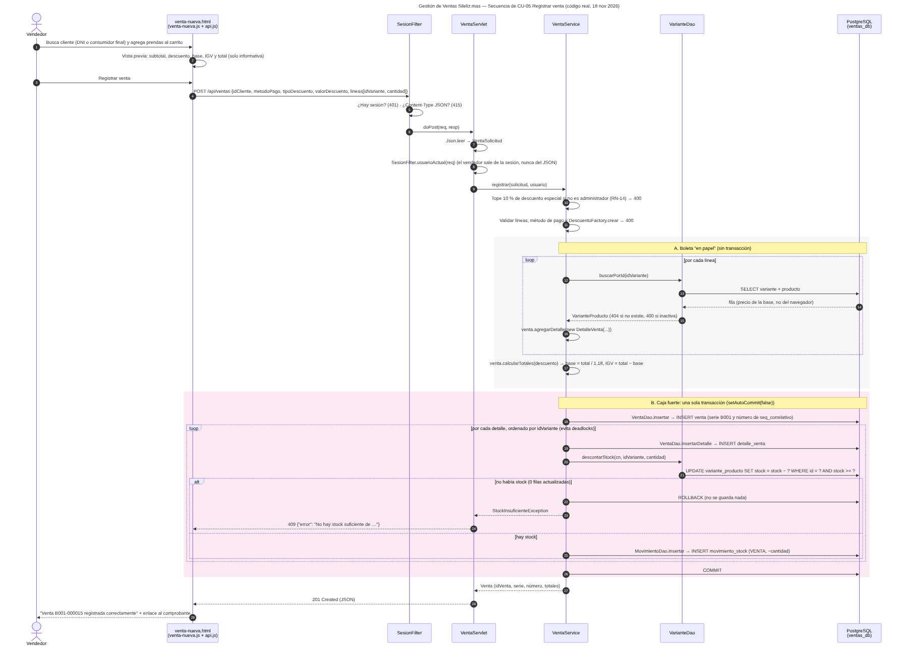

# Informe del proyecto — Gestión de Ventas Sileliz.mas

**Curso:** Programación Orientada a Objetos — TECSUP, 2.º ciclo, 2026
**Equipo:** Rafael, Cesia, Naomi, Luz y Mateo
**Entrega:** viernes 20 de noviembre de 2026
**Versión:** v2 final (18 de noviembre de 2026)

## Índice

| Sección | Contenido | Archivo | Responsable |
|---|---|---|---|
| 1 | Marco del proyecto: problema, objetivos y alcance | este archivo | Mateo (preparó Rafael como suplente) |
| 2 | Requisitos, reglas de negocio y casos de uso | este archivo | Mateo (preparó Rafael como suplente) |
| 3 | Gestión de riesgos | este archivo | Mateo (preparó Rafael como suplente) |
| 4 y 5 | Base de datos: modelo, normalización, diccionario, scripts, consultas y diagrama de clases | [`informe-base-de-datos.md`](informe-base-de-datos.md), [`diagrama-clases.png`](diagrama-clases.png) | Rafael |
| 6 | Diagrama de secuencia de la venta (CU-05) | este archivo y [`diagrama-secuencia.png`](diagrama-secuencia.png) | Luz (preparó Rafael como suplente) |
| 7 | Pruebas: resumen en este archivo; casos y resultados en [`plan-pruebas.md`](plan-pruebas.md) | Mateo / Cesia (ejecutó Rafael el 16 nov) |
| 8 | Uso de inteligencia artificial | [`bitacora-ia.md`](bitacora-ia.md) | Todos |
| 9 y 10 | Conclusiones y mejoras para la versión 2 | este archivo | Todos |
| Anexo A | Acta de entrevista con la tienda | [`entrevista.md`](entrevista.md) | Mateo (preparó Rafael) |
| Anexo B | Entorno y versiones oficiales | [`entorno.md`](entorno.md), [`../README.md`](../README.md) | Mateo |
| Anexo C | Manual de usuario con capturas | [`manual-usuario.md`](manual-usuario.md) | Naomi y Cesia (preparó Rafael como suplente) |

---

## 1. Marco del proyecto

### 1.1 La empresa

**Sileliz.mas** es una tienda de Trujillo que vende ropa de tallas grandes para mujer (tallas L a 4XL), con el lema
*"Más que una talla"*. La administra su dueño y atienden dos vendedores. Recibe mercadería todas las semanas, de Lima y de China,
y acepta pagos en efectivo, Yape, Plin, tarjeta, transferencia y pago link. Hoy registra sus ventas en un sistema comercial
(Keyfácil) y está en trámite de pasar del NRUS a una EIRL (fuente: [acta de entrevista](entrevista.md), 14 nov 2026).

### 1.2 Problema

El problema que más afecta al dueño es **no saber qué prendas se venden más**. Además, el stock de una tienda de ropa no se
controla por producto sino por **talla y color**: una blusa puede tener unidades en 2XL negro y ninguna en 3XL negro.
Sin un registro que descuente cada venta de la variante exacta y deje constancia de cada movimiento, el stock deja de cuadrar
y no hay datos confiables para decidir qué volver a comprar.

### 1.3 Objetivos

**Objetivo general.** Desarrollar una aplicación web en Java (Servlets y programación orientada a objetos) con PostgreSQL
que registre las ventas de Sileliz.mas de forma segura, controle el stock por talla y color y muestre qué se vende más.

**Objetivos específicos.**

1. Diseñar una base de datos normalizada (3FN) con 9 tablas, restricciones, vistas y triggers que protejan las ventas.
2. Implementar una arquitectura en capas (página → filtro → servlet → servicio → DAO → base) con una API JSON.
3. Registrar cada venta en una **transacción**: o se guardan la venta, el detalle, el descuento de stock y el kárdex, o no se guarda nada.
4. Aplicar seguridad: claves con PBKDF2, roles con permisos en el servidor, consultas parametrizadas y salida con `textContent`.
5. Ofrecer reportes de ventas por fechas, prendas más vendidas y ventas por vendedor.
6. Aplicar los principios de POO vistos en clase: herencia (`Persona` → `Cliente`, `Usuario`), polimorfismo (`Descuento` con
   `SinDescuento`, `DescuentoPorcentaje` y `DescuentoPorCantidad`), encapsulamiento y excepciones propias.

### 1.4 Alcance

**Incluye:** inicio de sesión con roles, productos con tallas y colores, categorías, clientes, nueva venta con carrito y descuentos,
comprobante interno imprimible, historial y anulación de ventas, ingreso de mercadería con kárdex, reportes, estadísticas del día,
usuarios y página de ayuda.

**No incluye (versión 2):** facturación electrónica ante SUNAT, pago link, reportes de ganancia y de rotación (necesitan el costo
de compra), devoluciones y ventas por internet. El comprobante es interno y sin valor tributario.

---

## 2. Requisitos, reglas de negocio y casos de uso

### 2.1 Actores y permisos

| Módulo | Administrador | Vendedor |
|---|---|---|
| Inicio y estadísticas | Sí | Sí |
| Productos y variantes | Crear, editar, desactivar, ingresar mercadería | Solo consulta |
| Categorías | Crear, editar, desactivar | No |
| Clientes | Crear, editar, desactivar | Crear, editar y consultar |
| Nueva venta | Sí | Sí (descuento especial hasta 10 %) |
| Ventas realizadas | Todas | Solo las propias |
| Anular venta | Sí, con motivo | No |
| Comprobante | Sí | Sí |
| Reportes | Sí | No |
| Usuarios | Sí | No |
| Ayuda | Sí | Sí |

El menú oculta lo que no corresponde, pero lo que realmente protege es la verificación de rol en el servidor
(`SesionFilter` y los servicios).

### 2.2 Requisitos funcionales

Estado al 18 de noviembre de 2026 (✅ terminado y probado).

| ID | Requisito | Prioridad | CU | Prueba | Estado |
|---|---|---|---|---|---|
| RF-01 | Iniciar y cerrar sesión con usuario y clave | Debe | CU-01 | CP-01, CP-02 | ✅ |
| RF-02 | Bloquear el acceso 15 minutos tras 5 intentos fallidos | Debe | CU-01 | CP-03 | ✅ |
| RF-03 | Gestionar usuarios y roles | Debería | CU-02 | CP-04 | ✅ API (#50) y página `usuarios.html` (#60) |
| RF-04 | Gestionar categorías | Debe | CU-03 | CP-11 | ✅ `categorias.html` (#57) |
| RF-05 | Gestionar productos con variantes (talla, color, stock y stock mínimo) y desactivar | Debe | CU-03 | CP-05 | ✅ |
| RF-06 | Buscar, filtrar por categoría y paginar productos | Debe | CU-03 | CP-11 | ✅ |
| RF-07 | Resaltar y listar productos con stock bajo | Debe | CU-03, CU-10 | CP-11 | ✅ |
| RF-08 | Gestionar clientes y buscarlos por nombre o DNI | Debe | CU-04 | CP-06 | ✅ |
| RF-09 | Registrar venta con carrito, método de pago, cliente opcional y descuento | Debe | CU-05 | CP-07 | ✅ |
| RF-10 | Descontar stock de forma atómica y registrar el movimiento | Debe | CU-05 | CP-08, CP-09 | ✅ |
| RF-11 | Emitir comprobante imprimible con serie y correlativo | Debe | CU-06 | CP-12 | ✅ |
| RF-12 | Consultar ventas con paginación, filtro por fechas y detalle | Debe | CU-07 | CP-11 | ✅ |
| RF-13 | Anular una venta con motivo y reponer el stock | Debería | CU-08 | CP-10 | ✅ |
| RF-14 | Reporte de ventas por rango de fechas; más vendidos y por vendedor | Debe / Debería | CU-09 | CP-07 | ✅ |
| RF-15 | Mostrar estadísticas del día en Inicio | Debería | CU-10 | CP-07 | ✅ |
| RF-16 | Mostrar los datos de la tienda en el comprobante y usar IGV 18 % | Debería | CU-06 | CP-12 | ✅ |
| RF-17 | Página de Ayuda | Podría | — | — | ✅ según el rol (#51, #63) |
| RF-18 | Exportar reporte a CSV | Podría | CU-09 | — | No se hizo (plan B) |
| RF-19 | Registrar el ingreso de mercadería por talla con su movimiento de stock | Debería | CU-11 | CP-18 | ✅ |

RF-19 y CU-11 se agregaron durante el proyecto: sin ellos el stock solo podía bajar (ventas) o volver (anulaciones),
pero nunca subir con la mercadería que llega cada semana.

### 2.3 Requisitos no funcionales

| ID | Categoría | Requisito | Cómo se comprueba |
|---|---|---|---|
| RNF-01 | Compilación | Clean and Build termina en `BUILD SUCCESSFUL` en las 5 computadoras con las mismas versiones | Prueba de humo |
| RNF-02 | Seguridad | PBKDF2, `PreparedStatement` en todo SQL, `textContent` en la interfaz, solo JSON en la API y sesión con tiempo límite | CP-14 a CP-16 |
| RNF-03 | Integridad | La venta es una transacción: o se guarda completa o no se guarda nada | CP-08 y CP-09 |
| RNF-04 | Usabilidad | Mensajes claros de éxito y error, confirmaciones antes de desactivar o anular | Lista de verificación |
| RNF-05 | Responsive | Se ve y funciona en 360, 768 y 1280 px | CP-13 |
| RNF-06 | Ortografía | UTF-8, `lang="es"`, tildes y ñ correctas en toda la interfaz | Lista de ortografía |
| RNF-07 | Mantenibilidad | Capas separadas: sin SQL en servlets, sin reglas de negocio en DAO ni en JS | Revisión de Pull Request |
| RNF-08 | Rendimiento | Listas de 10 filas por página; respuesta menor a 2 s | Prueba con datos masivos |
| RNF-09 | Recuperación | La base se recrea desde cero con los scripts de `bd/` | CP-17 |
| RNF-10 | Documentación | Javadoc en modelo y servicios; README con pasos de instalación | Revisión final |

### 2.4 Reglas de negocio

Las marcadas con ★ se confirmaron o cambiaron en la entrevista del 14 de noviembre.

| ID | Regla | Dónde se cumple |
|---|---|---|
| RN-01 ★ | El precio incluye IGV (18 %). Base imponible = total / 1,18; IGV = total − base | `Venta.calcularTotales` (`IGV_FACTOR`) |
| RN-02 | No se puede vender más unidades que el stock de la variante | `UPDATE ... SET stock = stock - ? WHERE stock >= ?` y `CHECK (stock >= 0)` |
| RN-03 | Una variante es la combinación única de producto, talla y color; el stock se controla por variante | `UNIQUE (id_producto, talla, color)` |
| RN-04 | El DNI tiene 8 dígitos y es único entre todas las personas; el teléfono tiene 9 dígitos y empieza con 9 | `Persona.validar`, `CHECK` y `UNIQUE` |
| RN-05 | Lo que tiene ventas no se elimina, se desactiva (productos, variantes, clientes y usuarios) | DAO con `activo = false`; trigger `trg_venta_protegida` |
| RN-06 | Se permite vender sin cliente (consumidor final); el comprobante dice "Cliente: Varios" | `venta.id_cliente` admite nulo |
| RN-07 ★ | Numeración serie y correlativo (B001-000015); comprobante interno, sin valor tributario | `seq_correlativo` |
| RN-08 ★ | Solo el administrador anula, con motivo obligatorio; la anulación repone el stock. Caso típico: la clienta pide su boleta con DNI | `VentaService.anular` |
| RN-09 | El precio y la descripción se guardan en el detalle; cambiar el producto después no altera ventas pasadas | `detalle_venta`; trigger `trg_detalle_venta_inmutable` |
| RN-10 ★ | Alerta de stock bajo cuando el stock es menor o igual al mínimo (2 por defecto) | Vista `v_stock_bajo` |
| RN-11 | La clave tiene al menos 8 caracteres con letras y números; 5 intentos fallidos bloquean 15 minutos | `Clave.cumplePolitica`, `AuthService` |
| RN-12 | El descuento se calcula sobre el total bruto, nunca lo supera y queda registrado en la venta | `Venta.calcularTotales` |
| RN-13 ★ | Descuento por cantidad: **15 % desde 3 prendas** | `DescuentoFactory` |
| RN-14 ★ | El vendedor puede dar un descuento especial de **hasta 10 %**; el administrador no tiene tope | `VentaService.TOPE_PORCENTAJE_VENDEDOR` |
| RN-15 | El stock solo cambia por una venta, una anulación o un ingreso de mercadería, siempre con su movimiento en el kárdex | `VentaService`, `IngresoService`, `movimiento_stock` |

### 2.5 Casos de uso

| ID | Caso de uso | Actor | Resumen |
|---|---|---|---|
| CU-01 | Iniciar sesión | Administrador, vendedor | Valida usuario y clave, crea la sesión y aplica el bloqueo por intentos |
| CU-02 | Gestionar usuarios | Administrador | Alta, edición, desactivación y restablecimiento de clave |
| CU-03 | Gestionar catálogo | Administrador (vendedor consulta) | Categorías, productos y variantes |
| CU-04 | Gestionar clientes | Administrador, vendedor | Alta, edición, búsqueda por nombre o DNI y desactivación |
| CU-05 | Registrar venta | Vendedor, administrador | Arma el carrito, aplica el descuento, guarda la venta y descuenta el stock |
| CU-06 | Imprimir comprobante | Vendedor, administrador | Muestra e imprime el comprobante de una venta |
| CU-07 | Consultar ventas | Vendedor (propias), administrador | Historial paginado con filtro por fechas y detalle |
| CU-08 | Anular venta | Administrador | Marca la venta como anulada y repone el stock |
| CU-09 | Consultar reportes | Administrador | Ventas por rango, productos más vendidos y ventas por vendedor |
| CU-10 | Ver resumen del día | Administrador, vendedor | Ventas y total del día, clientes y productos con stock bajo |
| CU-11 | Registrar ingreso de mercadería | Administrador | Suma unidades a una talla con un motivo y lo anota en el kárdex |

#### Especificación de CU-05: Registrar venta

| Elemento | Descripción |
|---|---|
| Precondiciones | Usuario autenticado (vendedor o administrador). Existe al menos una variante activa con stock. |
| Flujo principal | 1) Abre `venta-nueva.html`. 2) Busca un cliente por DNI o elige consumidor final. 3) Busca una prenda (nombre o SKU) y la agrega al carrito. 4) Repite el paso 3. 5) Elige el método de pago y el descuento. 6) La página muestra una vista previa de descuento, base imponible, IGV y total, solo informativa. 7) Confirma: la página envía solo ids y cantidades con `fetch POST /api/ventas`. 8) El servidor vuelve a leer los precios, calcula todo, guarda la venta, descuenta el stock y registra los movimientos en una sola transacción. 9) La página muestra "Venta B001-000015 registrada correctamente" con el enlace al comprobante. |
| Flujos alternos | A1) Cantidad mayor al stock: se avisa y no se agrega. A2) Carrito vacío: no se puede registrar. A3) El cliente no existe: se vende como consumidor final o se registra en Clientes. A4) El stock cambió mientras tanto (otra venta): el servidor hace rollback y responde 409. A5) El vendedor pone un descuento especial mayor a 10 %: responde 400 y no se guarda. A6) Falla la conexión: rollback y mensaje genérico 500. |
| Postcondiciones | La venta tiene serie y correlativo, el stock de cada variante bajó en lo vendido y hay un movimiento de stock por cada línea. |
| Reglas | RN-01, RN-02, RN-06, RN-07, RN-09, RN-12, RN-13, RN-14 |

---

## 3. Gestión de riesgos

| ID | Riesgo | Prob. | Impacto | Mitigación | Qué pasó en el proyecto |
|---|---|---|---|---|---|
| R1 | El alcance supera el tiempo disponible | Alta | Alto | Prioridades Debe/Debería/Podría, demos internas, plan B | Ocurrió en parte: se recortó RF-18 (CSV) y se pidió una excepción al congelamiento hasta el 16 nov para la ruta de la venta |
| R2 | Versiones distintas hacen que no compile en otra computadora | Media | Alto | Versiones oficiales, JAR en `lib/`, prueba de humo | Una integrante tenía dos PostgreSQL (16 y 18) y la aplicación usaba el que no tenía las vistas; se resolvió con `recrear_bd` y el puerto de `db.url` |
| R3 | Un integrante se atrasa | Media | Alto | Avisar temprano, suplentes, tablero | La gestión del proyecto se atrasó; el suplente (Rafael) completó el README, el acta, este informe y el plan de pruebas |
| R4 | Conflictos de Git por archivos compartidos | Alta | Medio | Archivos con dueño, PR pequeños, `git pull` diario | Ocurrieron dos (un record con el mismo nombre en dos ramas y pruebas agregadas al final de la misma clase); se resolvieron renombrando y reubicando |
| R5 | Código de IA que nadie entiende o con errores | Media | Alto | Política 1.5, bitácora, revisión cruzada | Ocurrió: código con clases inventadas, `javax` en vez de `jakarta` y parámetros cruzados; se detectó al compilar y probar (ver `bitacora-ia.md`) |
| R6 | Pérdida de datos o base imposible de recrear | Baja | Alto | Scripts versionados, `recrear_bd`, respaldo con `pg_dump` | No ocurrió; la base se recrea en un paso |
| R7 | La tienda no responde la entrevista a tiempo | Media | Medio | Supuestos documentados y constantes fáciles de cambiar | Ocurrió: la entrevista se hizo el 14 nov; los cambios (15 %, tope de 10 %, lema) se aplicaron en minutos gracias a las constantes |
| R8 | El profesor no acepta Servlets con API JSON y `fetch` | Baja | Alto | Consulta al inicio; servicio, DAO y modelo no cambian si se pasa a JSP | No ocurrió |
| R9 | Falla el equipo, internet o la energía el día de la entrega | Media | Alto | Funciona sin internet, copia en USB y en la nube, respaldo de la base, video de la demo, ensayo el 19 nov | Por verificar en el ensayo |
| R10 | Aprender Servlets y JSON toma más tiempo | Media | Medio | Nivelación, archivos `mock`, ayuda entre pares | Ocurrió al inicio; las páginas avanzaron con `web/mock` mientras se terminaban los servlets |

---

## 6. Diagrama de secuencia: registrar una venta (CU-05)

*Figura 6.1. Secuencia real de `POST /api/ventas`, sacada del código (`venta-nueva.js`, `SesionFilter`, `VentaServlet`,
`VentaService`, `VarianteDao`, `VentaDao`, `MovimientoDao`). Fuente: [`diagrama-secuencia.mmd`](diagrama-secuencia.mmd).*

Cómo leerlo:

1. **La página no decide nada importante.** `venta-nueva.js` solo envía ids de variante, cantidades, método de pago y
   descuento. La vista previa de totales es informativa: el servidor vuelve a leer los precios de la base.
2. **El portero (`SesionFilter`)** rechaza sin sesión (401) o sin JSON (415) antes de llegar al servlet.
3. **El servlet es delgado:** lee el JSON, toma al vendedor **de la sesión** (nunca del JSON) y llama al servicio.
4. **`VentaService` trabaja en dos fases:**
   - **A. "Boleta en papel"**: valida, aplica el tope de 10 % del vendedor (RN-14), busca cada variante y calcula
     subtotal, descuento, base e IGV (RN-01) sin abrir transacción.
   - **B. "Caja fuerte"**: en **una sola transacción** inserta la venta (toma su número de `seq_correlativo`), cada
     detalle, descuenta el stock con `UPDATE … WHERE stock >= ?` y registra el movimiento de kárdex. Si una sola prenda
     no tiene stock, hace **rollback** y responde **409**: no queda nada a medias (RF-10, CP-08 y CP-09).
5. Los detalles se procesan **ordenados por id de variante**, para que dos ventas simultáneas no se bloqueen entre sí.

---

## 7. Pruebas

| Nivel | Qué se probó | Resultado |
|---|---|---|
| Unitarias y de integración (JUnit) | Modelo (`Venta`, `Descuento`, `Clave`, `Validador`, `VarianteProducto`…), servicios con DAO falso y DAO contra PostgreSQL con rollback | **337 de 337** pasan (18 nov, con los PR #60, #62 y #63) |
| Funcionales y de seguridad (CP-01 a CP-18) | Login y bloqueo, permisos por rol, catálogo, clientes, venta con IGV y descuentos, stock insuficiente, concurrencia, anulación, paginación, comprobante, responsive, inyección SQL, XSS, POST sin JSON, ingreso de mercadería | Todos pasaron (16 nov); CP-04 se completó al unir `usuarios.html` (#60). CP-17 (recrear la base en las 5 PCs) se hace el 18–19 nov |
| Seguridad (lista 6.2 del plan) | SQL con `PreparedStatement`, `textContent`, secretos fuera del repositorio, privilegios mínimos de `ventas_app`, sesión, filtro | Aprobada (12 nov, repetida con lo nuevo el 16 nov) |

El detalle de cada caso, sus datos, la evidencia y las observaciones está en [`plan-pruebas.md`](plan-pruebas.md).

---

## 9. Conclusiones

1. **Se cumplió el objetivo:** el sistema cubre de punta a punta el trabajo diario de Sileliz.mas — ingreso con roles,
   catálogo con tallas y stock, clientes, venta con IGV incluido y descuentos, comprobante, anulación, llegada de
   mercadería, reportes y usuarios — y funciona sin internet en la computadora de la tienda.
2. **El stock es confiable:** solo cambia por venta, anulación o ingreso, siempre en una transacción y con su fila de
   kárdex. Esto resuelve el problema principal que contó el dueño: no saber qué se vende ni cuánto queda.
3. **Las capas ayudaron a cambiar rápido:** cuando la entrevista cambió reglas (15 % desde 3 prendas, tope de 10 % del
   vendedor, tallas L–4XL), bastó tocar constantes y el servicio, con pruebas que confirmaron el cambio.
4. **La seguridad se probó, no solo se escribió:** inyección SQL, XSS, accesos por rol y datos mal formados se
   intentaron a propósito y el sistema los rechazó.
5. **Trabajo en equipo con Git:** ramas por función, Pull Requests revisados por otra persona y `develop` protegido
   permitieron integrar cerca de 50 PR. Los atrasos se cubrieron con el sistema de suplentes del plan.
6. **La IA fue útil pero exigió revisión:** acelera, pero inventa nombres de clases y mezcla versiones; todo lo que
   entró se compiló, se probó y se entendió antes de unirlo (ver `bitacora-ia.md`).

## 10. Mejoras para la versión 2

| Mejora | Por qué | Origen |
|---|---|---|
| Pago con link (enlace de pago) como método nuevo | La tienda ya lo usa con algunas clientas | Entrevista 14 nov |
| Reportes de ganancia y rotación de inventario | Requieren guardar el costo de compra de cada prenda | Entrevista 14 nov |
| Impresión del comprobante en ticketera de rollo de 80 mm | La tienda comprará una ticketera | Decisión del dueño, 16 nov |
| Exportar reportes a CSV / Excel (RF-18) | Se recortó por tiempo (plan B) | Plan 9.7 |
| Boleta y factura electrónica con SUNAT | Fuera del alcance de este curso; la tienda pasa a EIRL | Entrevista 14 nov |
| Vitrina o catálogo con fotos para clientas | Prototipo de Cesia; necesita guardar imágenes por variante | Equipo |

