# Manual de usuario — Gestión de Ventas Sileliz.mas

**Sileliz.mas · Más que una talla**
Versión 1.0 · 18 de noviembre de 2026 · Equipo: Rafael, Cesia, Naomi, Luz y Mateo

Este manual explica cómo usar el sistema día a día en la tienda. Está escrito para quien atiende: no hace falta saber de computación.
Las imágenes son capturas reales del sistema con los datos de prueba.

---

## Índice

1. [Antes de empezar](#1-antes-de-empezar)
2. [Ingresar y salir](#2-ingresar-y-salir)
3. [Inicio: el resumen del día](#3-inicio-el-resumen-del-día)
4. [Registrar una venta](#4-registrar-una-venta)
5. [El comprobante](#5-el-comprobante)
6. [Ventas realizadas y anulación](#6-ventas-realizadas-y-anulación)
7. [Productos, tallas y llegada de mercadería](#7-productos-tallas-y-llegada-de-mercadería)
8. [Categorías](#8-categorías)
9. [Clientes](#9-clientes)
10. [Reportes](#10-reportes)
11. [Usuarios](#11-usuarios)
12. [Ayuda, modo oscuro y uso en celular](#12-ayuda-modo-oscuro-y-uso-en-celular)
13. [Problemas frecuentes](#13-problemas-frecuentes)

---

## 1. Antes de empezar

### Quién puede hacer qué

| Acción | Administrador | Vendedor |
|---|:---:|:---:|
| Registrar ventas y ver el comprobante | ✅ | ✅ |
| Ver ventas realizadas | ✅ todas | ✅ solo las suyas |
| Anular una venta | ✅ | — |
| Dar descuento especial (porcentaje) | ✅ sin tope | ✅ hasta **10 %** |
| Ver productos y tallas | ✅ | ✅ (solo mirar) |
| Crear o editar productos, tallas y categorías; registrar llegada de mercadería | ✅ | — |
| Registrar y editar clientes | ✅ | ✅ |
| Desactivar clientes | ✅ | — |
| Reportes y Usuarios | ✅ | — |

El menú de arriba **solo muestra lo que cada uno puede usar**. El vendedor no ve Categorías, Usuarios ni Reportes.

### Reglas de la tienda que aplica el sistema

- **Los precios ya incluyen IGV (18 %).** El comprobante separa la base imponible y el IGV.
- **Descuento por cantidad:** 15 % cuando el carrito tiene 3 prendas o más.
- **Tallas:** L, XL, 2XL, 3XL y 4XL.
- **Stock bajo:** cuando quedan tantas unidades como el mínimo (2) o menos.
- **Nada se borra:** productos, clientes y usuarios se *desactivan*, y las ventas se *anulan*. Así no se pierde la historia.
- El stock **solo cambia** con una venta (baja), una anulación (vuelve) o una llegada de mercadería (sube). No se escribe a mano.

---

## 2. Ingresar y salir

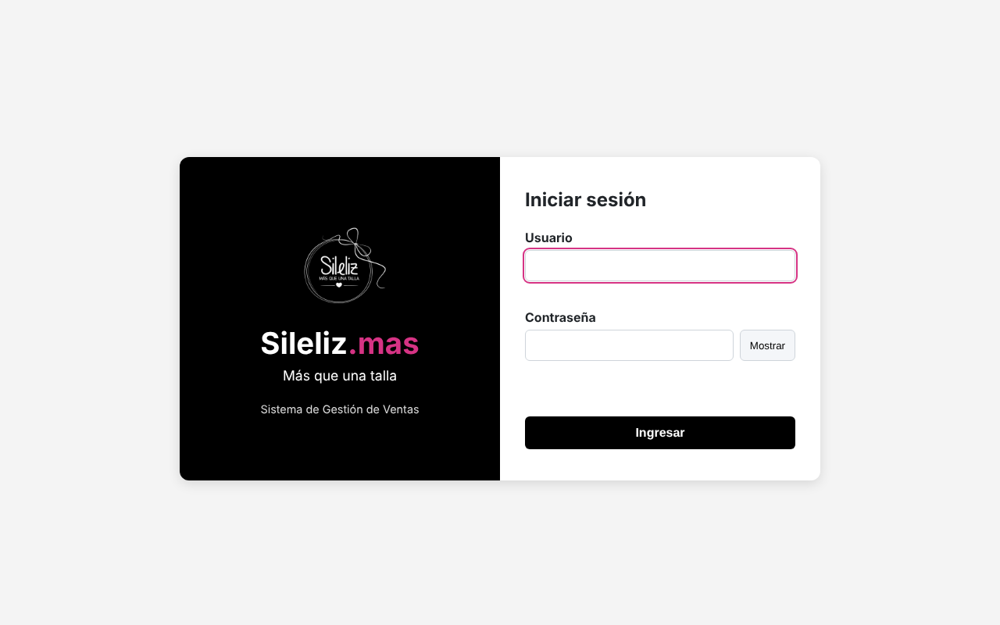

1. Abra el navegador en la dirección del sistema (en la tienda: `http://localhost:8080/sileliz/`).
2. Escriba su **Usuario** y su **Contraseña**. Con el botón **Mostrar** puede ver lo que escribió.
3. Presione **Ingresar**.

- Si se equivoca, sale *"Usuario o clave incorrectos."* (no dice cuál de los dos, por seguridad).
- Después de **5 intentos fallidos seguidos**, la cuenta se bloquea **15 minutos**. El administrador puede desbloquearla antes desde **Usuarios → Clave** (sección 11).
- La sesión se cierra sola después de **30 minutos sin uso**.
- Para salir, presione **Cerrar sesión** (arriba a la derecha). Hágalo siempre al terminar el turno.

---

## 3. Inicio: el resumen del día

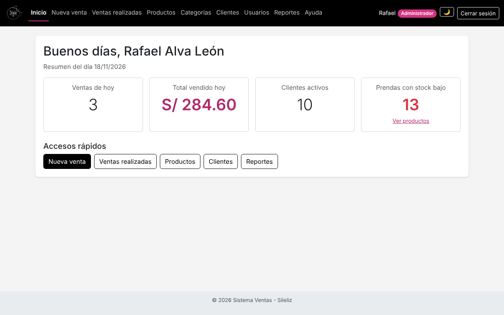

Al ingresar verá:

- **Ventas de hoy** y **Total vendido hoy** (sin contar las anuladas).
- **Clientes activos.**
- **Prendas con stock bajo**, en rojo. Con **Ver productos** va directo a la lista.
- **Accesos rápidos** a las pantallas más usadas.

Arriba a la derecha aparece su nombre con una etiqueta de su rol (**Administrador** o **Vendedor**).

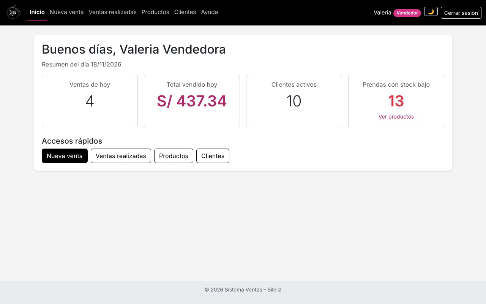

---

## 4. Registrar una venta

Menú **Nueva venta**. La pantalla tiene 3 partes: **1. Cliente**, **2. Buscar prenda** y **3. Carrito**.

### Paso 1: el cliente

- Si pide comprobante con su nombre: escriba el **DNI** (8 dígitos) y presione **Buscar**. Debajo aparece *Cliente: nombre (DNI …)*.
- Si no da sus datos: presione **Consumidor final**. En el comprobante saldrá **"Varios"**.
- Si el DNI no está registrado, regístrelo en **Clientes** (sección 9) y vuelva.

### Paso 2: las prendas

1. En **Nombre o SKU** escriba parte del nombre (por ejemplo `blusa`) o el código SKU (por ejemplo `P-001-XL-BLA`) y presione **Buscar**.
2. La lista muestra talla, color, precio y **stock**. Presione **Agregar** en la que se lleva.
3. Si una talla no tiene stock, el stock sale en rojo (**0**) y el botón dice **Sin stock**: no se puede agregar.

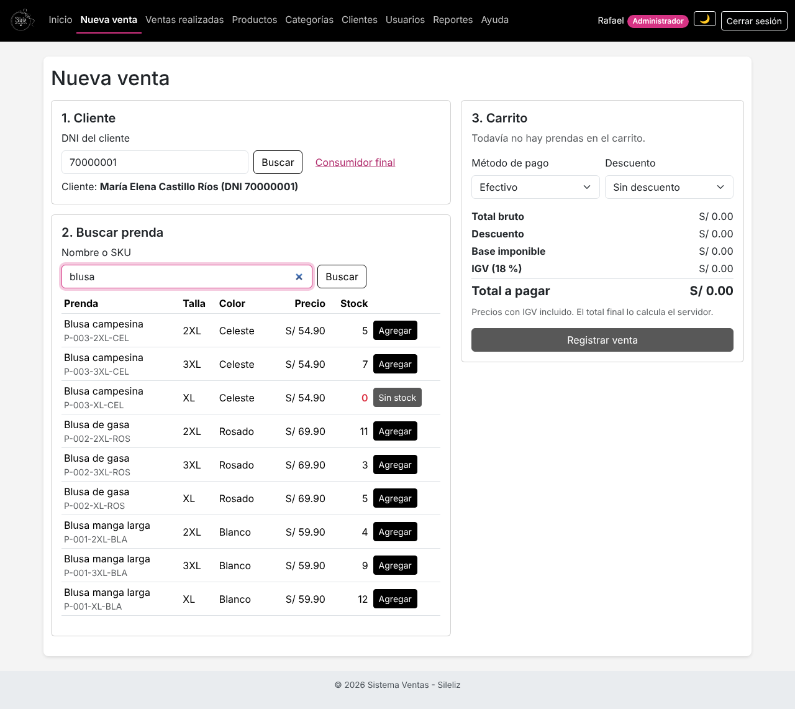

### Paso 3: el carrito, el pago y el descuento

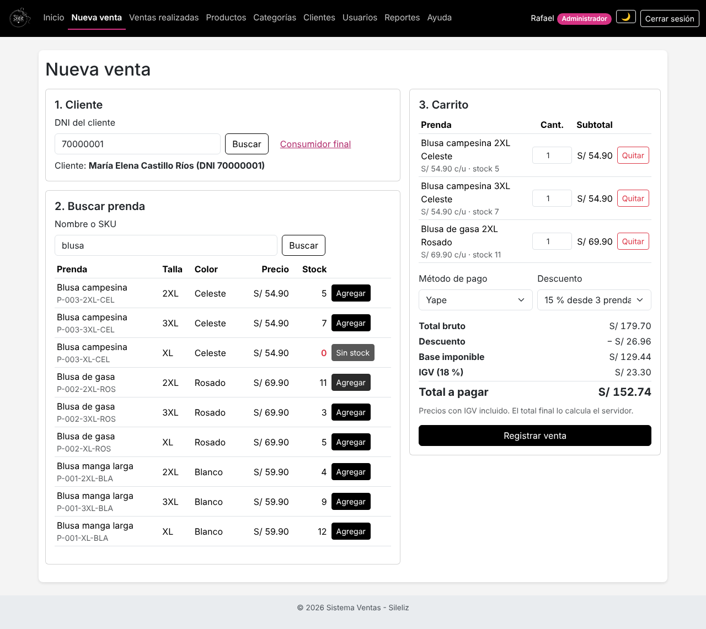

1. En el carrito puede cambiar la **Cant.** No deja pasar del stock que hay (avisa *"Solo hay N unidad(es)…"*). Con **Quitar** saca una prenda.
2. Elija el **Método de pago**: Efectivo, Yape, Plin, Tarjeta o Transferencia.
3. Elija el **Descuento**:
   - **Sin descuento.**
   - **15 % desde 3 prendas** (si hay menos de 3, no se aplica).
   - **Porcentaje…**: escriba el porcentaje. El vendedor puede dar **hasta 10 %**; si pone más, el sistema avisa *"Como vendedor puede dar como máximo 10 % de descuento especial. Para más, pida al administrador."*
4. Revise los totales: **Total bruto, Descuento, Base imponible, IGV (18 %) y Total a pagar.** Es una vista previa: el total final lo calcula el servidor con los precios guardados.
5. Presione **Registrar venta**.

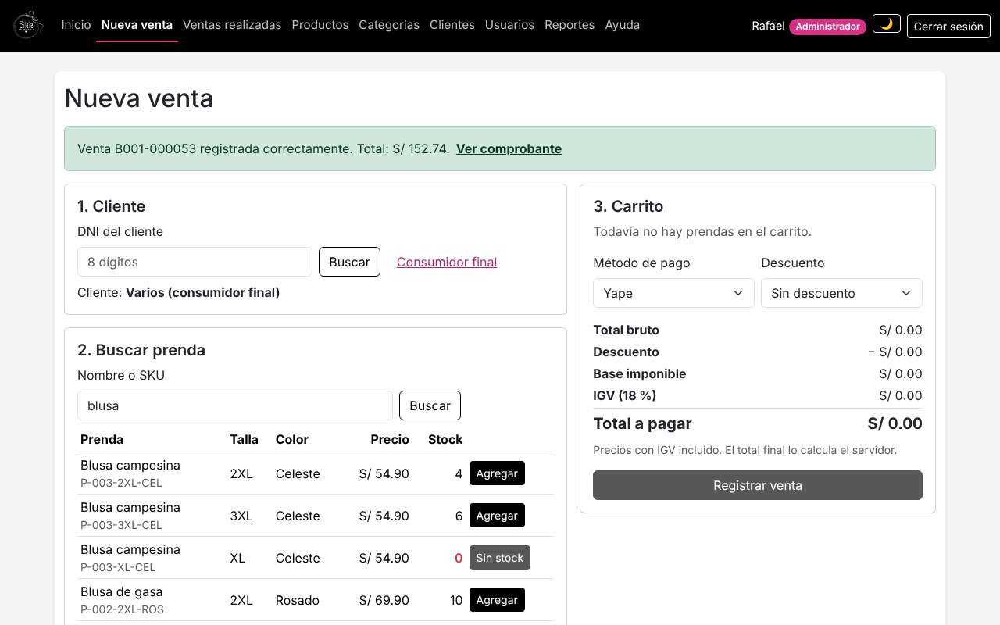

Sale el mensaje *"Venta B001-… registrada correctamente. Total: S/ …"* con el enlace **Ver comprobante**. El stock de cada prenda baja en ese momento.

> **Si sale "No hay stock suficiente de …":** otra persona vendió esa prenda mientras usted armaba el carrito. No se guardó nada. Baje la cantidad o elija otra talla y registre de nuevo.

---

## 5. El comprobante

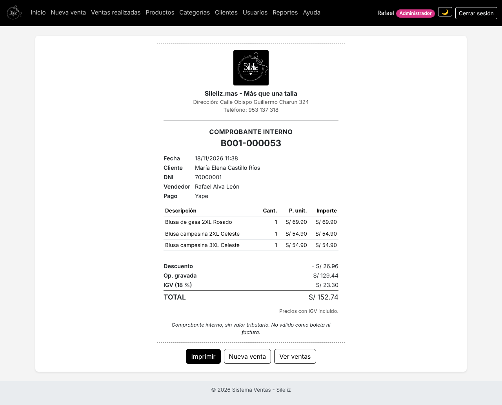

Muestra el logo, el lema, la dirección y el teléfono de la tienda, el número **B001-000…**, la fecha, el cliente con su DNI, el vendedor, el método de pago, el detalle de prendas, el descuento, la **Op. gravada**, el **IGV** y el **TOTAL**.

- **Imprimir**: sale en una hoja A4 limpia, sin menú ni botones. Para quitar la fecha y la dirección que agrega el navegador arriba y abajo, en *Más ajustes* desmarque *Encabezados y pies de página*.
- **Nueva venta** y **Ver ventas** llevan a esas pantallas.
- Es un **comprobante interno, sin valor tributario**: no reemplaza la boleta ni la factura de SUNAT.
- Si la venta fue anulada, el comprobante muestra el sello rojo **ANULADA** y el motivo.

---

## 6. Ventas realizadas y anulación

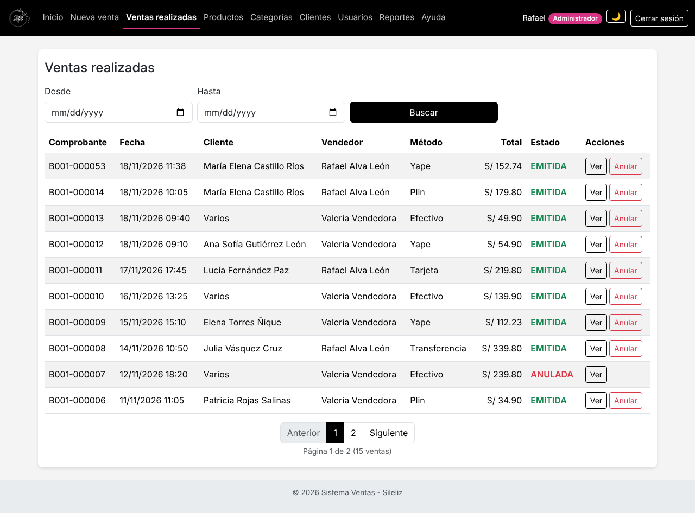

1. Menú **Ventas realizadas**. Aparecen las ventas de la más nueva a la más antigua, de 10 en 10 (**Anterior**, números, **Siguiente**).
2. Para ver un rango, elija **Desde** y **Hasta** y presione **Buscar**.
3. **Ver** abre el comprobante de esa venta.
4. El vendedor ve solo sus ventas; el administrador ve todas.

### Anular una venta (solo administrador)

Se usa, por ejemplo, cuando la clienta pide boleta con DNI y hay que rehacerla.

1. Presione **Anular** en la venta.
2. Escriba el **motivo** (obligatorio, hasta 200 letras) y acepte.
3. La venta queda **ANULADA** en rojo, las prendas **vuelven al stock** y la venta no se borra. Una venta anulada no se puede anular otra vez.

---

## 7. Productos, tallas y llegada de mercadería

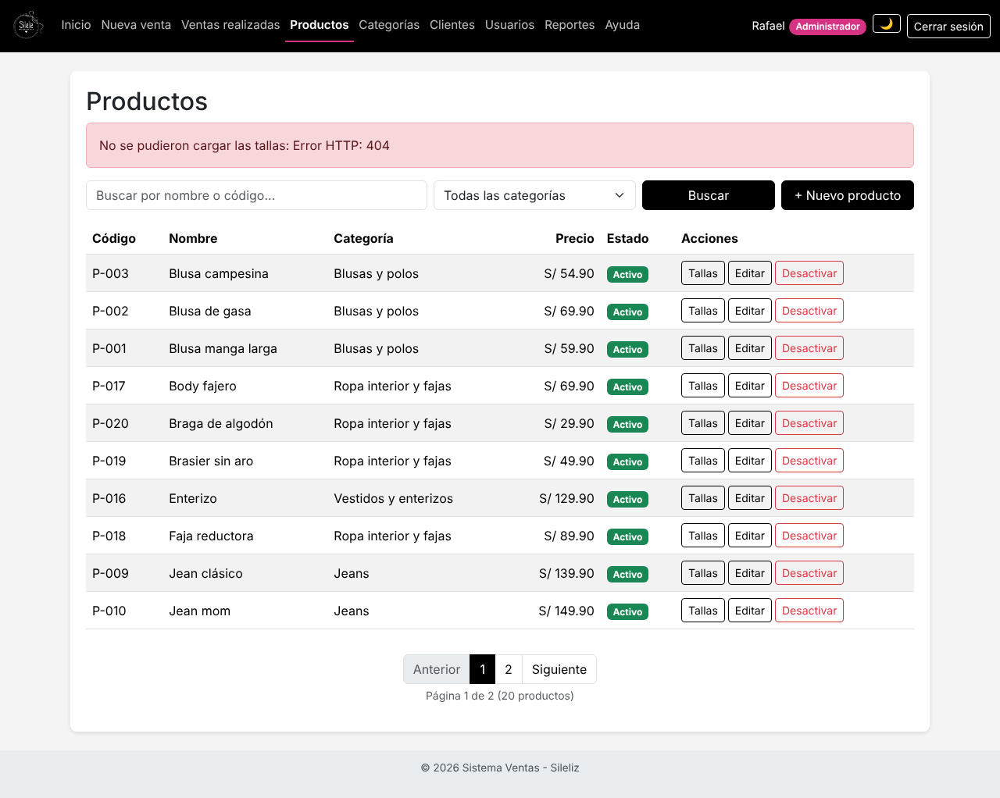

- Menú **Productos**: lista de 10 en 10 con **buscador** (nombre o código) y **filtro por categoría**.
- El vendedor solo consulta.

### Crear o editar un producto (administrador)

1. **+ Nuevo producto** (o **Editar** en la fila).
2. Complete **Código** (por ejemplo `P-021`), **Nombre**, **Categoría**, **Descripción** (opcional) y **Precio de venta (S/)**, que debe ser mayor que 0.
3. **Guardar**. Después se agregan las tallas.
4. **Desactivar** lo retira de la venta sin borrar su historia.

### Tallas y colores

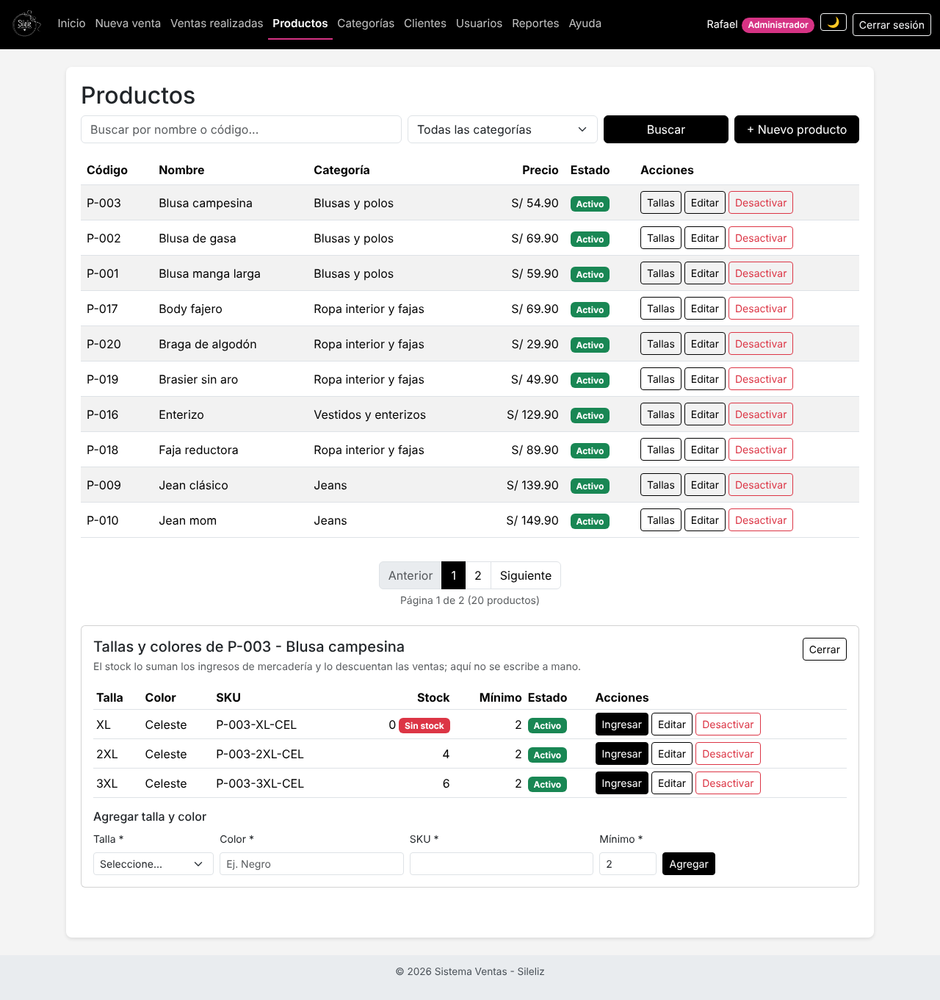

1. Presione **Tallas** en el producto.
2. Verá cada talla y color con su **SKU**, **Stock**, **Mínimo** y estado (**Stock bajo** en amarillo, **Sin stock** en rojo).
3. Para agregar una: en **Agregar talla y color** elija la **Talla** de la lista (L a 4XL), escriba el **Color**, revise el **SKU** sugerido y el **Mínimo**, y presione **Agregar**.

### Cuando llega mercadería (administrador)

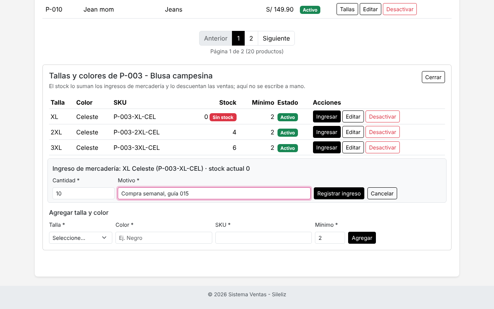

1. En **Tallas**, presione el botón **Ingresar** de la talla que llegó.
2. Escriba la **Cantidad** (de 1 a 999) y el **Motivo**, por ejemplo *"Compra semanal, guía 015"*.
3. **Registrar ingreso**. Sale *"Ingreso registrado: +N de SKU. Stock actual: X."* Queda anotado quién lo hizo y cuándo.

---

## 8. Categorías

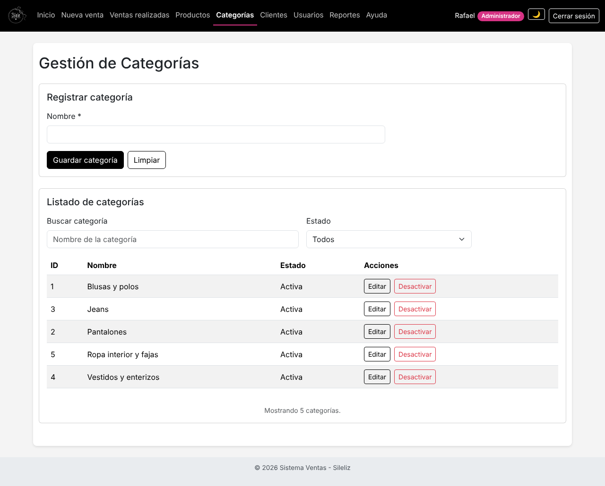

Solo el administrador. Escriba el **Nombre** y presione **Guardar categoría** (**Limpiar** borra el formulario). En la lista, **Editar** cambia el nombre y **Desactivar** la retira (pide confirmación). Como todo en el sistema, una categoría no se borra: sus productos y ventas se conservan.

---

## 9. Clientes

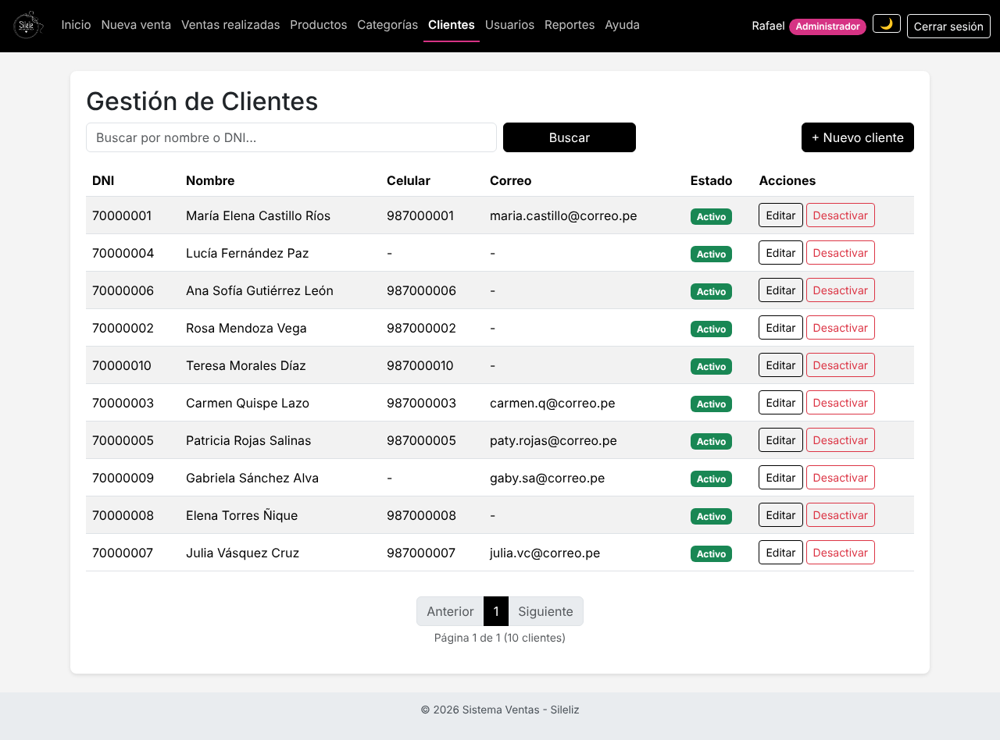

1. Menú **Clientes**: lista de 10 en 10 con buscador por nombre o DNI.
2. **+ Nuevo cliente** abre el formulario:

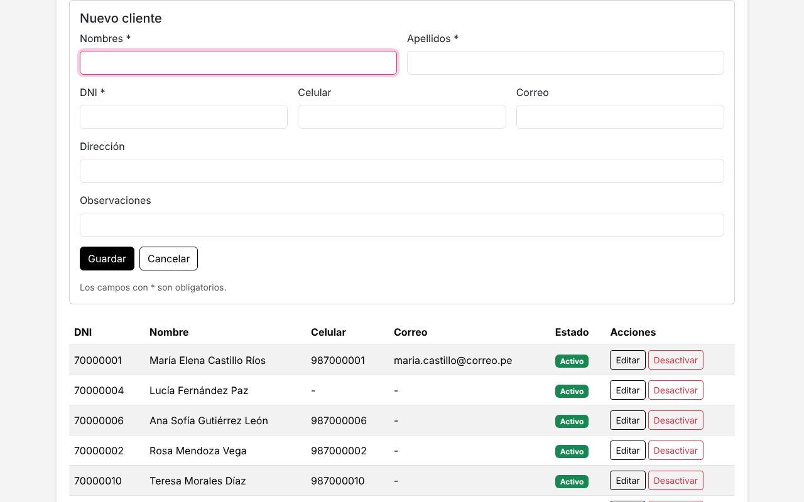

- **Nombres**, **Apellidos** y **DNI** son obligatorios. El DNI tiene **8 dígitos** y no se puede repetir (*"Ya existe una persona con ese DNI."*).
- **Celular** (9 dígitos, empieza con 9), **Correo**, **Dirección** y **Observaciones** son opcionales.

3. **Editar** cambia sus datos. **Desactivar** (solo el administrador) lo retira sin perder sus compras.

---

## 10. Reportes

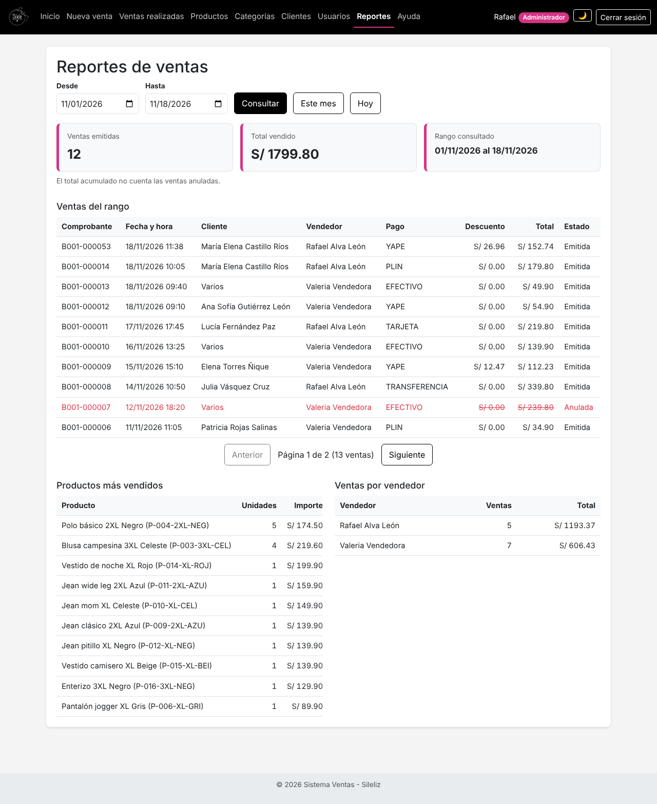

Solo el administrador.

1. Elija **Desde** y **Hasta** y presione **Consultar**, o use **Este mes** u **Hoy**.
2. Verá:
   - **Ventas emitidas** y **Total vendido** del rango (sin las anuladas).
   - **Ventas del rango**, de 10 en 10; las anuladas aparecen en rojo.
   - **Más vendidos**: las prendas que más salen.
   - **Por vendedor**: cuántas ventas y cuánto vendió cada uno.

---

## 11. Usuarios

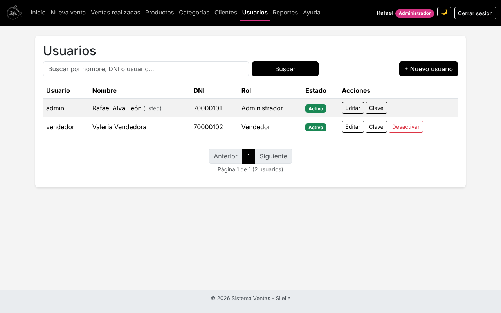

Solo el administrador. Su propio usuario aparece con **(usted)**.

- **+ Nuevo usuario**: nombres, apellidos, DNI, **Usuario** (4 a 30 letras, números, punto o guion bajo), **Rol** y **clave inicial**.
- **La clave** debe tener al menos 8 caracteres, con letras y números.
- **Editar** cambia los datos (no la clave).
- **Clave**: pone una clave nueva (se escribe dos veces). También **desbloquea** a quien se equivocó 5 veces.
- **Desactivar** impide que ese usuario ingrese; **Activar** lo devuelve. El administrador no puede desactivarse a sí mismo ni quitarse el rol, para que la tienda nunca se quede sin administrador.

---

## 12. Ayuda, modo oscuro y uso en celular

**Ayuda** (menú): guía corta por temas. Toque cada tema para ver los pasos. Al vendedor solo le muestra lo que él puede hacer.

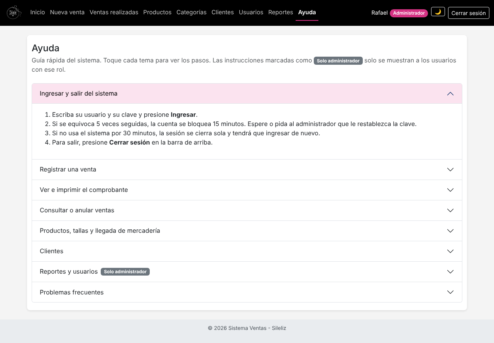

**Modo oscuro:** el botón 🌙 de arriba cambia a fondo oscuro (☀️ vuelve al claro). El sistema recuerda su elección en esa computadora. El comprobante siempre se ve e imprime en blanco.

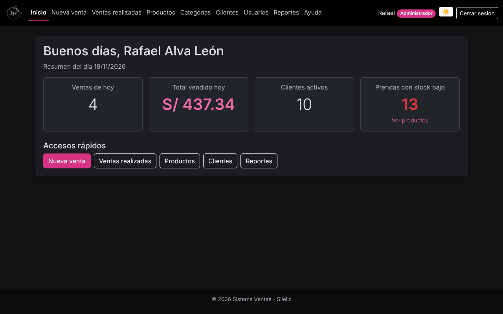

**En celular o tablet:** el menú se guarda en el botón ☰. Todas las pantallas se acomodan al ancho, sin moverse de lado.

| Nueva venta en celular | Menú abierto |
|---|---|
| 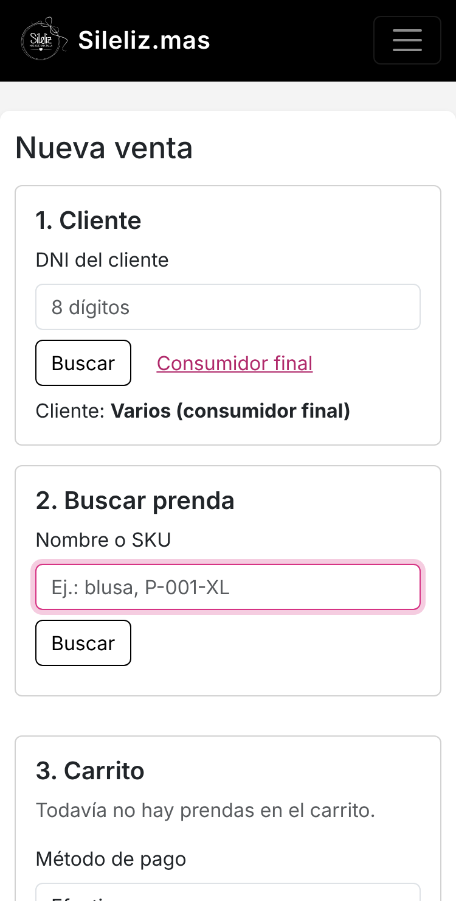 | 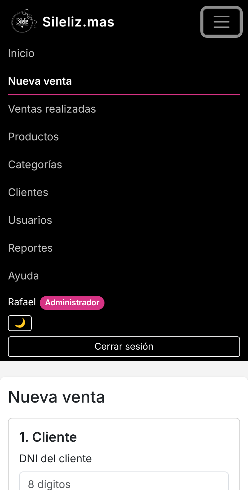 |

---

## 13. Problemas frecuentes

| Qué pasa | Qué significa y qué hacer |
|---|---|
| *"Usuario o clave incorrectos."* | Revise mayúsculas y que no esté activado Bloq Mayús. |
| *"Cuenta bloqueada por 15 minutos."* | Hubo 5 intentos fallidos. Espere o pida al administrador **Usuarios → Clave**. |
| La página volvió a la pantalla de ingreso | La sesión se cerró por 30 minutos sin uso. Ingrese de nuevo. |
| *"No hay stock suficiente de …"* | Otra venta se llevó esa prenda. No se guardó nada: ajuste el carrito y registre de nuevo. |
| *"No tiene permiso para esta acción."* | Esa opción es solo del administrador. |
| *"Como vendedor puede dar como máximo 10 %…"* | Baje el descuento o pida al administrador que registre la venta. |
| Saltó un número de comprobante (por ejemplo, de 000015 a 000017) | Es normal: una venta que falló (por ejemplo, sin stock) ya había tomado su número. No falta ninguna venta. |
| *"Ocurrió un error inesperado."* | Intente otra vez. Si se repite, avise al administrador con la hora y lo que estaba haciendo. |
| La página se ve rara o no cambia | Presione **Ctrl + F5** para recargarla. |
